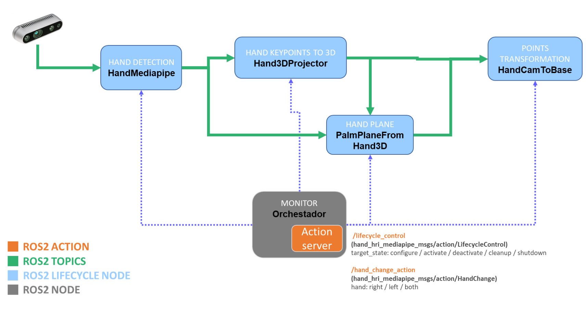
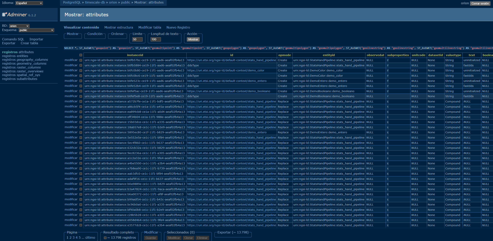
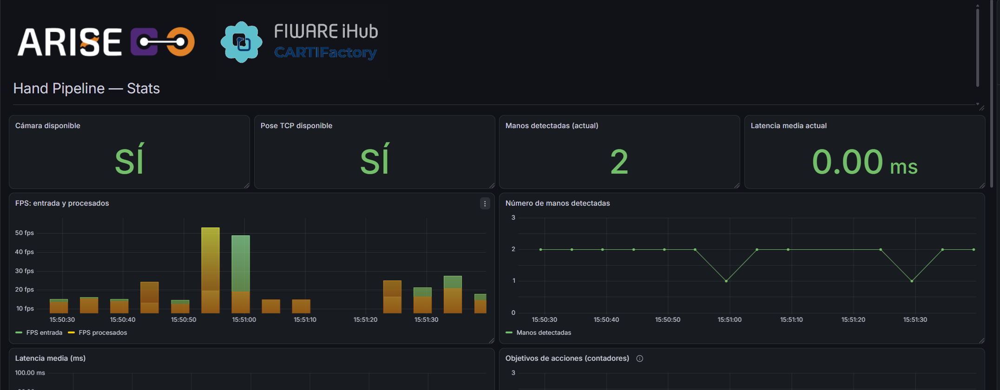

<p align="center">

  <!-- ---------- TOP IMAGE ---------- -->
  <a href="https://www.cartif.es/en/human-robot-collaboration-pilot-plant-cartifactory/">
    
  </a>
  <!-- ---------- CARTIF logo ---------- -->
  <a href="https://www.cartif.es/en/home/">
    
  </a>

</p>


# CARTIFactory, Middleware de Interacción Humano-Robot en Industria 5.

[](https://github.com/eProsima/vulcanexus)
[](https://releases.ubuntu.com/24.04/)


# Contenidos
- [CARTIFactory, Middleware de Interacción Humano-Robot en Industria 5.](#cartifactory-middleware-de-interacción-humano-robot-en-industria-5)
- [Contenidos](#contenidos)
- [Inicio](#inicio)
    - [1. Construir la imagen](#1-construir-la-imagen)
  - [2 Definir la entrada](#2-definir-la-entrada)
    - [2.1 Sin cámara física: utilizar un rosbag](#21-sin-cámara-física-utilizar-un-rosbag)
      - [Preparar las grabaciones y arrancar](#preparar-las-grabaciones-y-arrancar)
      - [Consultar y reproducir](#consultar-y-reproducir)
    - [2.2 Con cámara física: añadir el acceso USB](#22-con-cámara-física-añadir-el-acceso-usb)
  - [3. Configurar y activar el pipeline en ambos modos](#3-configurar-y-activar-el-pipeline-en-ambos-modos)
  - [4. Visualización mediante RViz2](#4-visualización-mediante-rviz2)
    - [Qué mostrar en RViz2](#qué-mostrar-en-rviz2)
  - [5. Configuración del Context Broker de FIWARE](#5-configuración-del-context-broker-de-fiware)
    - [5.1 Añadir nuevos topics](#51-añadir-nuevos-topics)
    - [5.2 Visualización de los datos](#52-visualización-de-los-datos)
    - [5.3 Mapping Tool](#53-mapping-tool)

# Inicio

El módulo puede recibir datos de una **cámara RealSense conectada por USB** o de un **rosbag grabado previamente**. Se utiliza la misma imagen Docker en ambos casos:

| Modo | Archivos Compose |
| --- | --- |
| Sin cámara física / reproducción de rosbag | `docker-compose.yml` |
| Con cámara RealSense USB | `docker-compose.yml` + `docker-compose-usb.yml` |

Ejecuta los comandos Docker desde la **raíz del repositorio**, en PowerShell, la terminal de VS Code o una terminal Linux con acceso a Docker. Los comandos ROS 2 se ejecutan **dentro del contenedor**.

> [!IMPORTANT]
> El Compose principal monta `./ros_bags:/ros_bags_source:ro` como origen de importación y el volumen persistente `ros_bags_data:/ros_bags` para reproducir. **No debe incluir el montaje de `/dev/bus/usb`**. Ese montaje pertenece exclusivamente a `docker-compose-usb.yml`. De lo contrario, el arranque sin cámara también exigirá el dispositivo USB.
>
> Los Compose arrancan el pipeline de los nodos del ciclo de vida ([*lifecycle* o *managed nodes*](https://design.ros2.org/articles/node_lifecycle.html)). **No lanzan automáticamente el driver de RealSense ni reproducen un rosbag.**

### 1. Construir la imagen

La primera vez, o después de modificar el Dockerfile, las dependencias o el código que se copia y compila dentro de la imagen:

```bash
docker compose -f docker-compose.yml build operator_tracking
```

Docker reutiliza las capas que no han cambiado. No es necesario reconstruir la imagen por conectar o desconectar la cámara, cambiar de modo o añadir nuevas grabaciones a `ros_bags/`.

## 2 Definir la entrada

Como se ha indicado en el apartado anterior, es posible probar este módulo utilizando una cámara Realsense conectada al ordenador (cosa que haremos nosotros en le workshop). Para facilitar la reproducibilidad y que podáis ver como funciona en vuestros esquipos, os proporcionamos una serie de ros bags, que podéis descargar del [siguiente enlace](https://filesender.rediris.es/?s=download&token=43aae319-a190-0868-5e4c-50cc763883bd).

### 2.1 Sin cámara física: utilizar un rosbag

#### Preparar las grabaciones y arrancar

Guarda cada grabación completa en `ros_bags/<nombre_del_bag>/`, dentro del repositorio. Debe incluir `metadata.yaml` y todos los archivos de datos que este referencia (`.mcap` o `.db3`).

El Compose monta dos rutas distintas dentro del contenedor:

| Ruta | Almacenamiento | Uso |
| --- | --- | --- |
| `/ros_bags_source` | Carpeta `./ros_bags` del host, montada en solo lectura. | Origen para importar grabaciones. |
| `/ros_bags` | Volumen persistente de Docker `operator_tracking_bags`. | Lectura y reproducción dentro del almacenamiento Linux de Docker. |

El volumen se crea si todavía no existe y se reutiliza en los siguientes arranques, tanto en modo cámara como en modo rosbag. No es necesario añadir un Compose específico para los bags.

Arrancamos el compose:
```bash
docker compose -f docker-compose.yml up -d
```
>[!warning]
>No añadas `docker-compose-usb.yml` ni ejecutes `usbipd attach` para este modo.

El entrypoint importa automáticamente los archivos nuevos desde `/ros_bags_source/` hacia `/ros_bags/` mediante `rsync -a --ignore-existing`, antes de lanzar el pipeline. La primera importación de grabaciones grandes puede tardar varios minutos. Los archivos ya existentes se omiten; si sustituyes un archivo conservando el mismo nombre, no se actualizará automáticamente.

Sigue el arranque desde el host:

```bash
docker compose -f docker-compose.yml logs -f operator_tracking
```

**Espera al mensaje siguiente antes de reproducir un bag:**

```text
[entrypoint] Grabaciones disponibles en /ros_bags.
```

Después aparecerán los logs de los nodos del pipeline. Pulsa `Ctrl+C` para salir del seguimiento de logs; esto no detiene el contenedor.

> [!IMPORTANT]
> Que Docker muestre el contenedor como `Started` o `Running` no significa que la importación haya terminado. Incluso es posible entrar con `docker exec` mientras se copian los bags.
>
> La carpeta y `metadata.yaml` pueden aparecer antes que el archivo de datos definitivo. Un nombre como `.robot_camera_20261020_133206_0.mcap.Fb89Dr` es un archivo temporal de `rsync`. No lo renombres: espera a que termine la copia. Si hay errores o reinicios continuos, revisa los logs.
>
> Las grabaciones copiadas sobreviven a la recreación del contenedor. `docker compose down -v` elimina los volúmenes gestionados por ese Compose, incluidas estas copias. Los originales de `./ros_bags` permanecen en el anfitrión.

#### Consultar y reproducir

Abre una terminal del contenedor:

```bash
docker compose -f docker-compose.yml exec operator_tracking bash
```

Dentro, comprueba la grabación antes de reproducirla:

```bash
ros2 bag info /ros_bags/robot_camera_20261020_133206
```

El siguiente comando se ha probado con esta grabación. Sustituye el nombre de la carpeta por el de tu bag y adapta la lista si sus topics son diferentes:

```bash
ros2 bag play /ros_bags/ROSBag1 \
  --clock \
  --read-ahead-queue-size 500 \
  --start-paused \
  --topics \
    /camera/cameraD455/color/image_raw \
    /camera/cameraD455/color/camera_info \
    /camera/cameraD455/aligned_depth_to_color/image_raw \
    /camera/cameraD455/aligned_depth_to_color/camera_info \
    /ur/tcp_pose \
    /tf \
    /tf_static \
    /robot_description
```

El reproductor arranca **pausado**. Deja esa terminal abierta, prepara el módulo y RViz en otras terminales y pulsa **Espacio** en la terminal del bag para comenzar. Espacio alterna pausa y reproducción; `Ctrl+C` detiene el reproductor.

| Opción | Función |
| --- | --- |
| `--clock` | Publica `/clock` con el tiempo de reproducción para los nodos que tengan `use_sim_time=true`. No cambia los timestamps guardados en los mensajes. |
| `--read-ahead-queue-size 500` | Configura una cola de lectura anticipada de 500 mensajes. No son 500 MB ni 500 fotogramas; el consumo de memoria depende del tamaño de los mensajes. |
| `--start-paused` | Permite preparar los consumidores antes de comenzar la reproducción. |
| `--topics` | Limita la reproducción a los topics enumerados. Reduce el tráfico publicado, aunque el formato de almacenamiento puede requerir leer o descomprimir bloques que contengan otros topics. |

Los topics seleccionados cumplen estas funciones:

| Topics | Uso |
| --- | --- |
| `.../color/image_raw` y `.../color/camera_info` | Imagen RGB para detección y datos de calibración. |
| `.../aligned_depth_to_color/image_raw` y  `.../aligned_depth_to_color/camera_info` | Información de profundidad alineada con el color para la proyección 3D. |
| `/ur/tcp_pose` | Pose TCP grabada, utilizada por la etapa de transformación cámara-base. |
| `/tf` y `/tf_static` | Transformaciones dinámicas y estáticas para situar los elementos en sus sistemas de coordenadas. |
| `/robot_description` | Descripción URDF que puede utilizar el display RobotModel de RViz. |

Este ejemplo no reproduce la nube de puntos ni `/joint_states`. Puedes añadirlos a la lista si los necesitas y están grabados. Los TF grabados ya permiten reproducir las transformaciones del robot, no hace falta lanzar simultáneamente otro publicador de esas mismas transformaciones.

Los nombres de cámara deben coincidir con la configuración del módulo, por defecto `cameraD455`. Si el bag utiliza otros nombres, adapta `CAMERA_NAME` o los remapeos.

Por defecto se realiza **una sola pasada** y el comando termina al finalizar la grabación. Para repetirla, añade `--loop` al comando anterior. En cada vuelta el tiempo de reproducción vuelve al comienzo: comprueba que los nodos, sus buffers y TF toleran ese salto. Si aparecen problemas justo al reiniciar, valida primero una sola pasada.

>[!warning] 
>**Rendimiento en la lectura y advertencias**
>
>En las pruebas con Windows, un bag MCAP de 6,4 GiB y unos 58 segundos provocaba este aviso al reproducirlo desde una carpeta de Windows montada directamente:
>
>```text
>Message queue starved. Messages will be delayed.
>```
>
>El aviso indica que el reproductor se queda sin mensajes preparados para publicar; **no demuestra por sí solo que el bag esté dañado**. Aumentar la cola y filtrar topics no bastó en esa prueba. La reproducción desde una copia en el almacenamiento Linux de Docker eliminó el aviso y mejoró la fluidez de imagen y TF. Por eso se utiliza el volumen persistente como origen de reproducción.
>
>Reproduce desde **`/ros_bags`**, no desde `/ros_bags_source`. Si el aviso continúa después de completar la importación, revisa la carga del equipo, la lectura/descompresión y los topics seleccionados; no aumentes indefinidamente la cola. El volumen utiliza el disco de datos configurado en Docker Desktop, que no tiene por qué estar en el mismo disco que el repositorio.

> [!important] 
> 
> **No mezclar apartados 2.1 y 2.2**
> 
> No ejecutes simultáneamente un driver de cámara o un publicador de TCP real que publique los mismos topics que el bag. Para trabajar con `--clock`, configura el tiempo simulado en los consumidores y en RViz como se indica en las secciones siguientes. Revisa también su QoS si faltan mensajes.

### 2.2 Con cámara física: añadir el acceso USB

>[!Note]
><details>
><summary>Añadir el acceso USB a Docker desde Windows</summary>
>Conecta la RealSense y cierra las aplicaciones que puedan estar utilizándola. **En Windows con WSL 2**, instala y configura previamente `usbipd-win` siguiendo la [guía de Microsoft](https://learn.microsoft.com/es-es/windows/wsl/connect-usb). Abre Ubuntu y déjalo en ejecución:
>
>```powershell
>wsl -d Ubuntu
>```
>
>En otra terminal de **PowerShell**, identifica la cámara y conéctala a WSL:>
>
>```powershell
>usbipd list
>usbipd attach --wsl --busid <BUSID>
>```
>
>Sustituye `<BUSID>` por el identificador actual de la RealSense. Si figura como `Not shared`, un administrador debe ejecutar primero `usbipd bind --busid <BUSID>`. Si ya figura como `Attached`, no repitas el attach.
></details>

Cuando el motor Linux de Docker tenga acceso al USB, arranca el módulo combinando los dos Compose:

```bash
docker compose -f docker-compose.yml -f docker-compose-usb.yml up -d
docker compose -f docker-compose.yml -f docker-compose-usb.yml exec operator_tracking bash
```

Dentro del contenedor, comprueba la visibilidad de la cámara y la existencia de su dispositivo:

```bash
lsusb
ls -l /dev/bus/usb/*/
```

Después lanza el driver. Este perfil utiliza color y profundidad a 640 × 480 y 15 FPS, con alineación y nube de puntos:

```bash
ros2 launch realsense2_camera rs_launch.py \
  camera_namespace:=camera \
  camera_name:=cameraD455 \
  device_type:=d455 \
  enable_color:=true \
  enable_depth:=true \
  enable_gyro:=false \
  enable_accel:=false \
  align_depth.enable:=true \
  pointcloud.enable:=true \
  pointcloud.allow_no_texture_points:=false \
  rgb_camera.color_profile:=640x480x15 \
  depth_module.depth_profile:=640x480x15 \
  decimation_filter.enable:=false \
  pointcloud.ordered_pc:=true \
  clip_distance:=2.0 \
  publish_tf:=true
```

Deja abierta esta terminal mientras utilizas la cámara. El nombre del driver debe coincidir con el del pipeline, por defecto `cameraD455`.

> [!WARNING] 
> **Problemas en la ruta /dev/bus/usb**
>
> Si aparece `bind source path does not exist: /dev/bus/usb`, el fallo se produce **al crear el contenedor**, no al construir la imagen. Comprueba el acceso USB desde el motor Linux de Docker. Que Windows o Ubuntu detecten la cámara no confirma por sí solo el acceso desde Docker.
>
> No crees una carpeta vacía para ocultar el error. Para trabajar con un rosbag, utiliza únicamente el Compose principal.

## 3. Configurar y activar el pipeline en ambos modos

Con el bag reproduciéndose o la cámara publicando, abre **otra terminal del contenedor** desde el host:

```bash
docker exec -it operator_tracking bash
```

>[!note] 
>**En caso de estar utilizando los ros bags**
>
>**En modo rosbag con `--clock`**, establece primero el tiempo simulado en los cinco nodos, antes de configurarlos y activarlos:
>
>```bash
>ros2 param set /hand_mediapipe_node use_sim_time true
>ros2 param set /hand_landmarks_3d_node use_sim_time true
>ros2 param set /hand_palm_plane_node use_sim_time true
>ros2 param set /hand_cam_to_base_node use_sim_time true
>ros2 param set /orchestrator use_sim_time true
>```

**En modo cámara física**, utiliza `use_sim_time=false` (valor predeterminado). Si cambias de modo sin recrear los nodos, restablece ese parámetro a `false` en los cinco nodos. No actives el tiempo simulado sin una fuente de `/clock`.

Todos los nodos comienzan en modo `unconfigured`, podéis comprobarlo ejecutando el siguiente comando:
```bash
ros2 lifecycle get
```
Debemos pasar de `unconfigured` a `inactive`, y luego a `active`. Si ya están en `inactive`, ejecuta solo la activación. Podéis usar las siguientes llamadas a acciones para hacerlo, devolverán `success: true` y podréis continuar.
```bash
ros2 action send_goal /lifecycle_control hand_hri_mediapipe_msgs/action/LifecycleControl "{target_state: configure}" --feedback
ros2 action send_goal /lifecycle_control hand_hri_mediapipe_msgs/action/LifecycleControl "{target_state: activate}" --feedback
ros2 lifecycle get /hand_mediapipe_node
```


Tras configurar, el estado esperado es `inactive [2]`, tras activar, `active [3]`. Para comprobar el procesamiento:

```bash
ros2 topic echo /stats/hand_pipeline --once
```

<details>
<summary>Cambiar entre uso de cámara y rosbag</summary>
Para pasar de cámara a rosbag, detén primero el driver RealSense y ejecuta el comando de arranque **sin cámara**. Para pasar a cámara, detén la reproducción del bag, prepara el USB y ejecuta el comando **con cámara**.

Cambiar los montajes puede recrear `operator_tracking`: los procesos iniciados con `docker exec` terminan y hay que volver a lanzar la fuente de datos y repetir la configuración y activación lifecycle. **No requiere reconstruir la imagen.**

Consulta el estado y los logs con:

```bash
docker compose -f docker-compose.yml ps operator_tracking
docker compose -f docker-compose.yml logs --tail=80 operator_tracking
```
</details>

## 4. Visualización mediante RViz2

RViz2 se puede ejecutar en un **contenedor separado**, utilizando la misma imagen que el módulo. Mantén `operator_tracking` en ejecución y la cámara o el rosbag publicando. No es necesario instalar ROS 2 ni RViz en el sistema anfitrión.

Los ejemplos utilizan `ROS_DOMAIN_ID=0` y Fast DDS (`rmw_fastrtps_cpp`). El dominio debe coincidir con el del módulo y el reproductor del bag.

> [!IMPORTANT]
> **Transporte DDS y tiempo de ROS**
>
> Los comandos siguientes utilizan `FASTDDS_BUILTIN_TRANSPORTS=UDPv4`. Comprueba el transporte del módulo desde el host:
>
> ```bash
> docker inspect operator_tracking --format '{{range .Config.Env}}{{println .}}{{end}}'
> ```
>
> Si el módulo utiliza `UDPv4` o `DEFAULT`, estos ejemplos permiten comunicar mediante UDP, siempre que la red y los perfiles DDS lo permitan. Si utiliza **solo `SHM`**, cambia también la opción de RViz a `-e FASTDDS_BUILTIN_TRANSPORTS=SHM`. Para ese modo local ambos contenedores deben compartir la red y el espacio IPC; estos ejemplos y el Compose deben utilizar `network_mode: host` / `--network host` e `ipc: host` / `--ipc host`. Un participante configurado solo con SHM y otro solo con UDP no comparten transporte.
>
> Con un **rosbag que publica `/clock`**, utiliza `use_sim_time:=true`. Con una **cámara física**, cambia la última opción a `use_sim_time:=false`. RViz con tiempo simulado necesita que el reproductor esté publicando `/clock`.

<details>
<summary><strong>Windows con Docker Desktop, WSL 2 y WSLg</strong></summary>

En **PowerShell**, abre Ubuntu:

```powershell
wsl -d Ubuntu
```

Después ejecuta lo siguiente **en la terminal de Ubuntu**, no en PowerShell. Las barras `\` al final de cada línea son continuaciones de Bash. `docker.exe` invoca el cliente Docker de Windows, como en las pruebas de este entorno:

```bash
docker.exe run --rm -it \
  --name operator_tracking_rviz \
  --network host \
  --ipc host \
  -e DISPLAY=:0 \
  -e ROS_DOMAIN_ID=0 \
  -e RMW_IMPLEMENTATION=rmw_fastrtps_cpp \
  -e FASTDDS_BUILTIN_TRANSPORTS=UDPv4 \
  -e QT_X11_NO_MITSHM=1 \
  -e LIBGL_ALWAYS_SOFTWARE=1 \
  --mount 'type=bind,source=\\wsl.localhost\Ubuntu\mnt\wslg\.X11-unix,target=/tmp/.X11-unix,readonly' \
  cartifactory/operator-tracking:latest \
  rviz2 --ros-args -p use_sim_time:=true
```

Este montaje reutiliza el acceso gráfico de WSLg comprobado en Windows. Si la distribución tiene otro nombre, sustituye `Ubuntu` en `wsl -d` y en la ruta del montaje. Comprueba que WSLg está activo:

```bash
echo "$DISPLAY"
ls -l /mnt/wslg/.X11-unix/
```

En Docker Desktop, activa **Settings → Resources → Network → Enable host networking** y aplica los cambios para utilizar la función de red del host de Docker Desktop. Esta opción está disponible desde Docker Desktop 4.34.

</details>

<details>
<summary><strong>Linux de escritorio con Docker Engine y X11/XWayland</strong></summary>

En Linux se utiliza **`docker`**, sin `.exe`, y no se ejecuta `wsl`. Este ejemplo requiere una sesión gráfica con `DISPLAY` definido y el socket `/tmp/.X11-unix`; también puede funcionar en una sesión Wayland que proporcione XWayland. No es un ejemplo para un servidor sin entorno gráfico ni para un motor Docker remoto.

Desde una terminal de tu sesión gráfica, comprueba:

```bash
echo "$DISPLAY"
ls -l /tmp/.X11-unix/
```

Para este contenedor, que ejecuta RViz como `root`, autoriza temporalmente el acceso del usuario local `root` al servidor X:

```bash
xhost +si:localuser:root
```

Después arranca RViz:

```bash
docker run --rm -it \
  --name operator_tracking_rviz \
  --network host \
  --ipc host \
  -e DISPLAY="$DISPLAY" \
  -e ROS_DOMAIN_ID=0 \
  -e RMW_IMPLEMENTATION=rmw_fastrtps_cpp \
  -e FASTDDS_BUILTIN_TRANSPORTS=UDPv4 \
  -e QT_X11_NO_MITSHM=1 \
  -e LIBGL_ALWAYS_SOFTWARE=1 \
  --mount type=bind,source=/tmp/.X11-unix,target=/tmp/.X11-unix,readonly \
  cartifactory/operator-tracking:latest \
  rviz2 --ros-args -p use_sim_time:=true
```

`DISPLAY="$DISPLAY"` conserva el identificador de la pantalla de tu sesión; no tiene por qué ser `:0`. Esta receta supone Docker Engine local con el mapeo habitual del usuario `root`; con Docker rootless o remapeo de usuarios hay que adaptar la autorización gráfica.

Cuando cierres RViz, revoca la autorización temporal:

```bash
xhost -si:localuser:root
```

Si falta `xhost`, en Ubuntu se instala mediante `sudo apt install x11-xserver-utils`. Si tu usuario necesita `sudo` para usar Docker, utiliza `sudo docker run ...`; ejecuta `xhost` como tu usuario de la sesión gráfica.

</details>

### Qué mostrar en RViz2

Arrancar RViz abre la aplicación, pero **no carga automáticamente una configuración de visualización**. Añade los displays correspondientes o abre un archivo `.rviz` preparado para el workshop:

| Display | Configuración orientativa |
| --- | --- |
| `Image` | `/camera/cameraD455/color/image_raw` para el color, o `/humans/hands/debug_image` si el módulo está publicando la imagen de depuración. |
| `TF` | Ejes y transformaciones publicadas por la cámara, el robot o el bag. |
| `RobotModel` | Descripción en `/robot_description`, con las transformaciones necesarias y los paquetes de mallas disponibles en la imagen. |
| `Markers` | `/humans/hands/hand_x/landmarks3d_marker`, Los puntos 3D de las manos. |

Selecciona en **Global Options → Fixed Frame** un frame que exista en el árbol TF y permita transformar los elementos que quieras mostrar. Para superponer las manos 3D, añade los displays o plugins correspondientes a los tipos que publique el módulo; el topic `landmarks2d` por sí solo no crea una mano 3D en RViz.

Si un display no recibe datos, comprueba el nombre del topic, sus publicadores y su QoS:

```bash
ros2 topic info /camera/cameraD455/color/image_raw --verbose
```

Ajusta el QoS del display al del publicador. En las pruebas anteriores de este entorno, usar **Reliable** en el consumidor mejoró la recepción de imágenes de un publicador Reliable. Para datos en directo, `Volatile` evita solicitar muestras históricas; el modelo URDF y `/tf_static` pueden requerir `Transient Local` para recibir la última muestra publicada antes de abrir RViz.

`LIBGL_ALWAYS_SOFTWARE=1` fuerza el renderizado por CPU, como en las pruebas de Windows. Es una opción de compatibilidad, no aceleración GPU. En Linux, si se configura y valida el acceso a la GPU, puede adaptarse el arranque para utilizarla.

Al cerrar RViz, `--rm` elimina únicamente el contenedor `operator_tracking_rviz`; el módulo sigue ejecutándose. Este contenedor de visualización no necesita acceso USB ni montar los bags: recibe los datos mediante ROS 2.

## 5. Configuración del Context Broker de FIWARE

### 5.1 Añadir nuevos topics

El Context Broker, por defecto, lee todos los topics dentro de su misma red, pero eso no quiere decir que cree entidades NGSI-LD. Es necesario indicarle qué topics necesitamos indicar, editando el fichero `./fiware\out\dds-config.json`. Es necesario modificar los campos `allowlist` y `topics`, añadiendo los topics que se quieran dentro.

Hemos preparado un nodo de pruebas que publica tres topics sencillos para que aprendáis como se añaden nuevos mensajes y se crean nuevas entidades:

| Topic | Descripción |
| --- | --- |
| `demo/booleano` | Ejemplo de mensaje booleano, alternando entre *True* y *False*  |
| `demo/color` | Ejemplo de mensaje tipo string, publica una lista de colores en bucle. |
| `demo/entero` | Ejemplo de mensaje tipo entero, realiza un bucle entre los números 0-9. |

Por otro lado hemos dejado preparado otro mensaje propio `/stats/hand_pipeline`, para poder mostraros un ejemplo más completo y que veáis que no solo funciona con mensajes estándar de ROS2.

<details>
<summary>Modificación de allowlist</summary>

Dentro del campo de `topics` es necesario listar todos los topics a los que queremos que el Context Broker se suscriba. Es importante que al inicio del topic se ponga **`rt/`**.
```bash
"allowlist": [
  {"name": "rt/stats/hand_pipeline"},
  {"name": "rt/demo/booleano"},
  {"name": "rt/demo/color"},
  {"name": "rt/demo/entero"}
],
```
</details>

<details>
<summary>Definición de topics como entidades NGSI-LD</summary>

Más abajo es necesario definir el nombre de las entidades NGSI-LD. Es necesario definir un `entityType` y `attribute`, y utilizar ambos apra construir el `entityId` soguiendo el formato `urn:ngsi-ld:<entityType>:<attribute>`
```bash
"topics": {
  "rt/stats/hand_pipeline": {
    "entityId": "urn:ngsi-ld:StatsHandPipeline:stats_hand_pipeline",
    "entityType": "StatsHandPipeline",
    "attribute": "stats_hand_pipeline"
  },
  "rt/demo/color": {
    "entityId": "urn:ngsi-ld:DemoColor:demo_color",
    "entityType": "DemoColor",
    "attribute": "demo_color"
  },
  "rt/demo/entero": {
    "entityId": "urn:ngsi-ld:DemoEntero:demo_entero",
    "entityType": "DemoEntero",
    "attribute": "demo_entero"
  },
  "rt/demo/booleano": {
    "entityId": "urn:ngsi-ld:DemoBooleano:demo_booleano",
    "entityType": "DemoBooleano",
    "attribute": "demo_booleano"
  }
},
```
</details>

>[!important]
> El Orion Context Broker lee esta configuración cada vez que arranca, por lo que si se ha modificado mientras el contenedor esté levantado, es necesario reiniciar el contenedor.
>```bash
>docker compose up -d --no-deps --force-recreate mongodb timescale-db orion adminer grafana
>```

### 5.2 Visualización de los datos

Una vez tenemos el Context Broker reiniciado podemos acceder a las siguientes interfaces:
- Adminer (`http://localhost:8082`), con la configuración:

| Campo | Valor |
| ----- | ----- |
| Motor de base de datos | PostgreSQL |
| Usuario | orion |
| Contraseña | orion |
| Base de datos | orion |


- Grafana (`http://localhost:4430`), con el usuario y contraseña por defecto **admin**.



Para los tres topics que estamos usando de muestra, os proporcionamos las queries que son necesarias para mostrar los datos en Grafana:

<details>
<summary>Queries para <code>/demo/booleano</code></summary>

- Para obtener el último dato:
  
```bash
SELECT
  CASE compound::jsonb ->> 'data'
    WHEN 'true' THEN 1
    WHEN 'false' THEN 0
    ELSE NULL
  END AS "Booleano"
FROM public.attributes
WHERE entityid = 'urn:ngsi-ld:DemoBooleano:demo_booleano'
  AND $__timeFilter(ts)
  AND compound IS NOT NULL
  AND compound::jsonb ? 'data'
ORDER BY ts DESC
LIMIT 1;
```

- Para obtener el histórico:
```bash
SELECT ts AS "time",
  CASE compound::jsonb ->> 'data'
    WHEN 'true' THEN 1
    WHEN 'false' THEN 0
    ELSE NULL
  END AS "Booleano"
FROM public.attributes
WHERE entityid = 'urn:ngsi-ld:DemoBooleano:demo_booleano'
  AND $__timeFilter(ts)
  AND compound IS NOT NULL
  AND compound::jsonb ? 'data'
ORDER BY ts ASC;
```
</details>

<details>
<summary>Queries para <code>/demo/entero</code></summary>

- Para obtener el último dato:
  
```bash
SELECT (compound::jsonb ->> 'data')::integer AS "Entero"
FROM public.attributes
WHERE entityid = 'urn:ngsi-ld:DemoEntero:demo_entero'
  AND $__timeFilter(ts)
  AND compound IS NOT NULL
  AND compound::jsonb ? 'data'
ORDER BY ts DESC
LIMIT 1;
```

- Para el histórico:

```bash
SELECT ts AS "time",
  (compound::jsonb ->> 'data')::integer AS "Entero (0–9)"
FROM public.attributes
WHERE entityid = 'urn:ngsi-ld:DemoEntero:demo_entero'
  AND $__timeFilter(ts)
  AND compound IS NOT NULL
  AND compound::jsonb ? 'data'
ORDER BY ts ASC;
```

</details>

<details>
<summary>Queries para <code>/demo/color</code></summary>

- Para obtener el último dato:
  
```bash
SELECT
  CASE compound::jsonb ->> 'data'
    WHEN 'rojo' THEN 1
    WHEN 'verde' THEN 2
    WHEN 'azul' THEN 3
    WHEN 'amarillo' THEN 4
    WHEN 'naranja' THEN 5
    ELSE NULL
  END AS "Color"
FROM public.attributes
WHERE entityid = 'urn:ngsi-ld:DemoColor:demo_color'
  AND $__timeFilter(ts)
  AND compound IS NOT NULL
  AND compound::jsonb ? 'data'
ORDER BY ts DESC
LIMIT 1;
```

- Para el histórico:

```bash
SELECT ts AS "time",
  compound::jsonb ->> 'data' AS "Color"
FROM public.attributes
WHERE entityid = 'urn:ngsi-ld:DemoColor:demo_color'
  AND $__timeFilter(ts)
  AND compound IS NOT NULL
  AND compound::jsonb ? 'data'
ORDER BY ts DESC
LIMIT 60;
```

</details>

### 5.3 Mapping Tool
La herramienta de [mapeo entre DDS y NGSI-LD](https://github.com/Engineering-Research-and-Development/dds-ngsild-mapper) facilita el proceso de construir el `fiware\out\dds-config.json`, evitando que se tenga que hacer a mano. 

<details>
<summary>Para visualización</summary>

- En Linux:
```bash
export MAPPER_UID="$(id -u)"
export MAPPER_GID="$(id -g)"
```
- En Windows:
```bash
$env:MAPPER_UID = "1000"
$env:MAPPER_GID = "1000"
```
</details>

Se puede contruir la imagen previo a lanzar el contenedor:
```bash
docker compose -f docker-compose-mapping.yml build
```
Una vez construido se puede levantar:
```bash
docker compose -f docker-compose-mapping.yml up -d
```
La interfaz se lanzará en `http://localhost:3001/`. El discovery URL es `ws://host.docker.internal:8083`.


>[!tip]
> Si se quiere saber más sobre cómo se configura el Context Broker con ROS2, podéis revisar la [siguiente documentación](https://arise-framework-documentation.readthedocs.io/en/latest/rst/tutorials/tutorials.html).

---

<table>
  <tr>
    <td width="30%">
      
    </td>
    <td width="70%">
      <h3>CARTIFactory</h3>
      <p>
        Si estáis interesados en conocer más no olvidéis visitar la documentación de <a href="https://fundacion-cartif.github.io/CARTIFactory/es">CARTIFactory</a>!
        <br>
        Podéis solicitar una prueba experimental contactando con nosotros a través del siguiente <a href="mailto:marlod@cartif.es?subject=Solicitud%20Prueba%20CARTIFactory ">correo</a>.
      </p>
    </td>
  </tr>
</table>


>[!tip] 
>
>**Proyecto ARISE**
>
><p align="center">
>  <!-- ---------- ARISE logo ---------- -->
>  <!-- Light mode -->
>  
>  <!-- Dark mode -->
>  
></p>
>
> El proyecto [ARISE](https://arise-middleware.eu/) tiene como objetivo facilitar el acceso a tecnologías de interacción humano-robot (HRI) en entornos industriales, haciéndolas más accesibles y económicamente viables, especialmente en los sectores sanitario, intralogístico y manufacturero.
> 
>Estos módulos buscan integrar [FIWARE Orion Context Broker](https://fiware-orion.readthedocs.io/en/master/) y [eProsima Vulcanexus](https://vulcanexus.org/) para facilitar el desarrollo de aplicaciones robóticas e industriales capaces de adaptarse a su contexto. Además, incorporan [ROS4HRI](https://ros4hri.github.io/), un estándar abierto basado en ROS que proporciona un conjunto de paquetes diseñados para simplificar el desarrollo de capacidades de interacción humano-robot (HRI) en sistemas robóticos.
