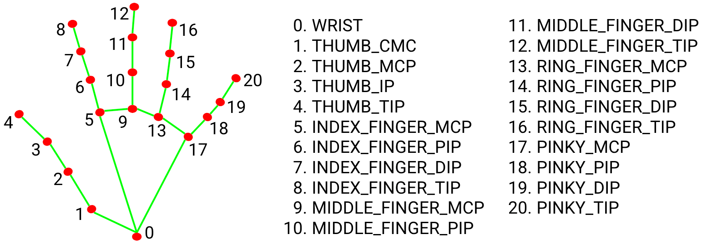

<p align="center">

<!-- ---------- TOP IMAGE ---------- -->

<a href="https://www.cartif.es/en/human-robot-collaboration-pilot-plant-cartifactory/">
    
  </a>
  <!-- ---------- CARTIF logo ---------- -->
  <a href="https://www.cartif.es/en/home/">
    
  </a>

</p>

<p align="center">
  <!-- ---------- ARISE logo ---------- -->
  <!-- Light mode -->
  
  <!-- Dark mode -->
  
</p>

<p align="center">
  These 
  Modules are part of the ARISE Middleware<br>
  <a href="https://arise-middleware.eu/">ARISE Middleware site</a>
</p>

<hr>

[](https://github.com/eProsima/vulcanexus)
[](https://releases.ubuntu.com/24.04/)

# General Overview

[ARISE](https://arise-middleware.eu/) aims towards making industrial HRI more accessible and cost-effective, in particular in healthcare, intra-logistics and manufacturing sectors. These modules hope to present an integration between [FIWARE Orion Context Broker](https://fiware-orion.readthedocs.io/en/master/) and [eProsima Vulcanexus](https://vulcanexus.org/) to enable context-aware robotic and industrial applications, alongside [ROS4HRI](https://ros4hri.github.io/) as an open-source ROS standard and a set of ROS packages to facilitate the development of Human-Robot Interaction (HRI) capabilities on robots.

> [!TIP]
> Check here the rest of our Testing and Experimenting Facility [CARTIFactory](https://fundacion-cartif.github.io/CARTIFactory/)!

## Features

- Real-time hand detection using MediaPipe Hands
- 2D and 3D hand landmark estimation
- Dynamic multi-hand tracking pipeline
- Palm plane estimation and normal computation
- Camera-to-robot base frame transformation
- ROS2 Lifecycle Node architecture
- Runtime hand selection (left, right, both)
- Custom ROS2 interfaces and actions
- Built-in monitoring and diagnostics interface

## Table of Contents

- [General Overview](#general-overview)

  - [Features](#features)
- [Getting started](#getting-started)

  - [Dependencies](#dependencies)
- [What is included in the module](#what-is-included-in-the-module)

  - [Hand Mediapipe node](#hand-mediapipe-node)## 2D Hand detection (`hand_mediapipe_node`)
  - [Hand landmarks 3D node](#hand-landmarks-3d-node)
  - [Hand palm plane node](#hand-palm-plane-node) ## Hand palm plane node (`hand_palm_plane_node`)
  - [Camera to robot frame hand transformation ](#camera-to-robot-frame-hand-transformation-(`hand_cam_to_base_node`))
- [Custom Interfaces](#custom-interfaces)
- [Running the Module](#running-the-module)

  - [Launch Arguments](#launch-arguments)

## Camera to robot frame hand transformation (`hand_cam_to_base_node`)

# Getting started

This module represents part of an operator detection system. This module is specialized in hand-tracking and processing, outputing a calculated plane and normal.

<p align="left">
  <!-- ---------- REUSABLE MODULE DIAGRAM ---------- -->
  <!-- Light mode -->
  

<!-- Dark mode -->


</p>

## Dependencies

All Python dependencies are included inside the `requirements.txt` file. To install, execute on terminal:

```bash
pip install -r /requirements.txt
```

This package is dependent on other ROS2 interfaces:

```bash
sudo apt install \
  ros-${ROS_DISTRO}-vision-msgs \
  ros-${ROS_DISTRO}-cv-bridge \
  ros-${ROS_DISTRO}-hri-msgs
```

# What is included in the module

## 2D Hand detection (`hand_mediapipe_node`)

ROS2 Lifecycle node responsible for detecting and tracking human hands from RGB images using MediaPipe Hands.

This node is the entry point of the hand-processing pipeline. It receives RGB images, performs hand landmark inference, identifies left and right hands, and publishes normalized 2D hand landmarks. The node also supports runtime hand selection (left, right, or both) through the orchestrator action interface.

### Inputs

* RGB camera images

### Outputs

* Tracked hand identifiers
* 2D hand landmarks
* 2D hand ROIs
* Debug visualization image

### Interfaces

This node has the following interfaces:

| Interface  | Topic                              | Description                                                                                                                   |
| ---------- | ---------------------------------- | ----------------------------------------------------------------------------------------------------------------------------- |
| Publisher  | `/humans/hands/tracked`          | List of currently tracked hand identifiers.                                                                                   |
| Publisher  | `/humans/hands/<id>/landmarks2d` | Normalized 2D landmarks for each detected hand.                                                                               |
| Publisher  | `/humans/hands/<id>/roi2d`       | Normalized 2D bounding box for each detected hand.                                                                            |
| Publisher  | `/humans/hands/debug_image`      | Debug visualization image with rendered landmarks.                                                                            |
| Subscriber | *`*image_topic`*               | RGB image topic configured through the `image_topic` parameter. Default value is `/camera/<camera_name>/color/image_raw`. |

## Hand landmarks 3D node (`hand_landmarks_3d_node`)

ROS2 Lifecycle node that reconstructs 3D hand landmarks from RGB-D information.

The node synchronizes 2D hand detections with depth images and camera intrinsic parameters to estimate the 3D position of each MediaPipe landmark in the camera reference frame. Processing pipelines are created dynamically for every tracked hand.

### Inputs

* 2D hand landmarks
* Depth image
* CameraInfo

### Outputs

* 3D hand landmarks
* RViz markers
* Optional point clouds

### Interfaces

| Interface  | Topic                                        | Description                                                                                                                         |
| ---------- | -------------------------------------------- | ----------------------------------------------------------------------------------------------------------------------------------- |
| Subscriber | `/humans/hands/tracked`                    | List of currently tracked hand identifiers.                                                                                         |
| Subscriber | `/humans/hands/<id>/landmarks2d`           | Normalized 2D landmarks for each detected hand.                                                                                     |
| Subscriber | `*image_topic`                             | RGB image topic configured through the `image_topic` parameter. Default value is `/camera/<camera_name>/color/image_raw`.       |
| Subscriber | `*camera_info_topic`                       | Camera intrinsic parameters used for 3D projection. Default value is `/camera/<camera_name>/aligned_depth_to_color/camera_info`. |
| Publisher  | `/humans/hands/<id>/landmarks3d`           | 3D hand landmarks expressed in the camera reference frame.                                                                          |
| Publisher  | `/humans/hands/<id>/landmarks3d_marker`    | RViz visualization of 3D landmarks.                                                                                                 |
| Publisher  | `/humans/hands/<id>/skeleton3d_marker`     | RViz visualization of the hand skeleton.                                                                                            |
| Publisher* | *`/humans/hands/<id>/landmarks3d_cloud`* | Optional PointCloud2 representation of hand landmarks.                                                                              |

> [!Important]
> Processing pipelines are created dynamically for each tracked hand. When a new hand identifier appears in `/humans/hands/tracked`, the node automatically creates the required subscribers, synchronizers and publishers. Resources are released when the hand is no longer tracked.

### 3D Reconstruction

For each valid 2D landmark, the node:

1. Converts normalized image coordinates into pixel coordinates.
2. Retrieves the corresponding depth value.
3. Uses the camera intrinsic parameters to deproject the pixel into a 3D point.
4. Publishes the resulting landmark in the camera reference frame.

Invalid depth measurements are automatically discarded and marked as invalid in the output message.

## Hand palm plane node (`hand_palm_plane_node`)

ROS2 Lifecycle node responsible for estimating the palm plane and its normal vector from 3D hand landmarks.

The node fits a plane using a configurable subset of hand landmarks and provides a stable estimation of palm orientation. This information can be used for gesture analysis, human-robot interaction, pointing estimation, or grasp intention inference.

> [!Important]
> The node dynamically creates and removes per-hand processing pipelines according to the currently tracked hands.

### Inputs

* 3D hand landmarks

### Outputs

* Palm plane estimation
* Palm centroid marker
* Palm normal marker
* Palm surface mesh (optional)

### Interfaces

| Interface  | Topic                                             | Description                                                     |
| ---------- | ------------------------------------------------- | --------------------------------------------------------------- |
| Subscriber | `/humans/hands/tracked`                         | List of currently tracked hand identifiers.                     |
| Subscriber | `/humans/hands/<id>/landmarks3d`                | 3D hand landmarks expressed in the camera reference frame.      |
| Publisher  | `/humans/hands/<id>/palm_plane_cam`             | Estimated palm plane expressed in the camera reference frame.   |
| Publisher  | `/humans/hands/<id>/palm_plane_centroid_marker` | RViz marker representing the palm centroid.                     |
| Publisher  | `/humans/hands/<id>/palm_plane_normal_marker`   | RViz marker representing the palm normal vector.                |
| Publisher* | `/humans/hands/<id>/palm_plane_mesh_marker`     | Optional RViz mesh visualization of the estimated palm surface. |

### Plane Estimation

The palm plane is estimated from a configurable subset of landmarks using least-squares plane fitting based on Singular Value Decomposition (SVD).

The resulting normal vector can be stabilized through:

- Initial camera-facing orientation
- Sign consistency enforcement
- Angular step limiting
- Exponential moving average filtering

### Mesh Generation

When enabled, the node projects valid landmarks onto the estimated plane, computes a 2D convex hull, triangulates the polygon, and publishes a `TRIANGLE_LIST` RViz marker representing the palm surface.

## Camera to robot frame hand transformation (`hand_cam_to_base_node`)

ROS2 Lifecycle node that transforms hand-related information from the camera reference frame into the robot base frame.

Using the current robot TCP pose and a calibrated camera-to-TCP transformation, the node computes hand landmarks and palm planes expressed in robot coordinates. This enables downstream robotic applications to reason directly in the robot workspace.

### Inputs

* Hand landmarks in camera frame
* Palm plane in camera frame
* TCP pose

### Outputs

* Hand landmarks in robot base frame
* Palm plane in robot base frame
* Optional RViz markers

### Interfaces

This node has the following interfaces:

| Interface  | Topic                                   | Description                                                                                                 |
| ---------- | --------------------------------------- | ----------------------------------------------------------------------------------------------------------- |
| Subscriber | `/humans/hands/tracked`               | List of currently tracked hand identifiers.                                                                 |
| Subscriber | `/humans/hands/<id>/landmarks3d`      | 3D hand landmarks expressed in the camera reference frame.                                                  |
| Subscriber | `/humans/hands/<id>/palm_plane_cam`   | Palm plane estimation expressed in the camera reference frame.                                              |
| Subscriber | `*tcp_pose_topic`                     | Current robot TCP pose used to compute the camera-to-base transformation. Default value is `/ur/tcp_pose` |
| Publisher  | `/humans/hands/<id>/landmarks3d_base` | 3D hand landmarks transformed into the robot base reference frame.                                          |
| Publisher  | `/humans/hands/<id>/palm_plane_base`  | Palm plane transformed into the robot base reference frame.                                                 |
| Publisher* | `/humans/hands/<id>/centroid_marker`  | Optional RViz marker showing the palm centroid in the robot base frame.                                     |
| Publisher* | `/humans/hands/<id>/normal_marker`    | Optional RViz marker showing the palm normal vector in the robot base frame.                                |

> [!Important]
>
> The node dynamically creates and removes processing pipelines for each tracked hand. A dedicated transformation pipeline is instantiated whenever a new hand identifier appears in `/humans/hands/tracked`.

### Coordinate Transformation

The node combines:

- The current robot TCP pose
- The calibrated camera-to-TCP transformation (`T_cam_tcp`)
- The hand landmarks and palm plane estimated in the camera frame

to compute the corresponding hand representation in the robot base frame.

This allows downstream robotic applications to directly use hand positions, palm centroids and palm normals without requiring additional coordinate transformations.

# Custom Interfaces

A `custom_interfaces` package is included, to handle the custom message for the pipeline information and the goal

## Hand Tracking Message

Message definition for representing a tracked hand using MediaPipe landmarks:


| Field          | Type                                         | Description                                                                       |
| -------------- | -------------------------------------------- | --------------------------------------------------------------------------------- |
| `id`         | `string`                                   | Unique identifier for the detected hand or tracked person.                        |
| `handedness` | `uint8`                                    | Indicates whether the detected hand is left or right.                             |
| `landmarks`  | `hri_msgs/NormalizedPointOfInterest2D[21]` | Array containing the 21 MediaPipe hand landmarks in normalized image coordinates. |
| `confidence` | `float32`                                  | Confidence score of the hand detection/tracking.                                  |

> [!Note]
> Handedness Convention
>
> | Constant               | Value | Description          |
> | ---------------------- | ----- | -------------------- |
> | `HANDEDNESS_UNKNOWN` | `0` | Unknown handedness.  |
> | `HANDEDNESS_LEFT`    | `1` | Left hand detected.  |
> | `HANDEDNESS_RIGHT`   | `2` | Right hand detected. |

## Hand Tracking 3D Message

Message definition for representing a tracked hand in 3D space using MediaPipe landmarks.

| Field          | Type                        | Description                                                                          |
| -------------- | --------------------------- | ------------------------------------------------------------------------------------ |
| `id`         | `string`                  | Unique identifier for the detected hand or tracked person.                           |
| `handedness` | `uint8`                   | Indicates whether the detected hand is left or right.                                |
| `confidence` | `float32`                 | Confidence score of the handedness classifier. If unavailable, use `NaN` or `0`. |
| `landmarks`  | `geometry_msgs/Point[21]` | Array containing the 21 MediaPipe hand landmarks in normalized image coordinates.    |
| `valid`      | `bool[21]`                | Indicates whether each landmark is valid/tracked.                                    |

> [!Note]
> Landmark coordinates are expressed in 3D space using `geometry_msgs/Point`. The `valid` array allows checking whether each landmark has been successfully estimated. `valid[i] == false` means landmark `i` should not be considered reliable.

# Landmarks

## Pipeline Statistics

For the sending the diagnostics to the Context Broker we use a custom interface `custom_interfaces/PipelineStats` with the followind definition:

| Field   | Type    | Description |
| ------- | ------- | ----------- |
| `---` | `---` | ---         |

## Lifecycle action

All nodes will start as `unconfigured` upon launching the module. To unify the initialization of the system, we have created an `orchestrator` that hosts two actions, the first one being an action to change state to all the nodes in the correct order.

### Goal

| Field            | Type       | Description                            |
| ---------------- | ---------- | -------------------------------------- |
| `target_state` | `string` | State we want to change the system to. |

### Result

| Field          | Type       | Description                                                    |
| -------------- | ---------- | -------------------------------------------------------------- |
| `success`    | `bool`   | Indicates whether the action execution completed successfully. |
| `result_msg` | `string` | Final message resulting from the execution of the action.      |

### Feedback

| Field        | Type       | Description                                                                  |
| ------------ | ---------- | ---------------------------------------------------------------------------- |
| `feedback` | `string` | Informational message describing the current status of the action execution. |

## Hand change action

The second action from the `orchestrator` is created for changing which hand is going to be tracked. Options are **left**, **right** or **both**.

### Goal

| Field    | Type       | Description                                          |
| -------- | ---------- | ---------------------------------------------------- |
| `hand` | `string` | Hand we want to track. Options: (left, right, both). |

### Result

| Field          | Type       | Description                                                    |
| -------------- | ---------- | -------------------------------------------------------------- |
| `success`    | `bool`   | Indicates whether the action execution completed successfully. |
| `result_msg` | `string` | Final message resulting from the execution of the action.      |

### Feedback

| Field        | Type       | Description                                                                  |
| ------------ | ---------- | ---------------------------------------------------------------------------- |
| `feedback` | `string` | Informational message describing the current status of the action execution. |

# Running the Module

The launch file starts the full hand-tracking pipeline:

```bash
ros2 launch hand_hri_mediapipe hand_pipeline_lifecycle.launch.py
```

## Launch Arguments

| Argument        | Default        | Type   | Description                                                              |
| --------------- | -------------- | ------ | ------------------------------------------------------------------------ |
| `camera_name` | `cameraD455` | string | Camera namespace used to build the color, depth, and camera info topics. |

---

This project has received funding from **Horizon Europe** research and innovation programme under grant agreement **no. 101135784**.

<p align="left">
  <!-- ---------- ARISE logo ---------- -->
  <!-- Light mode -->
  

<!-- Dark mode -->


</p>
