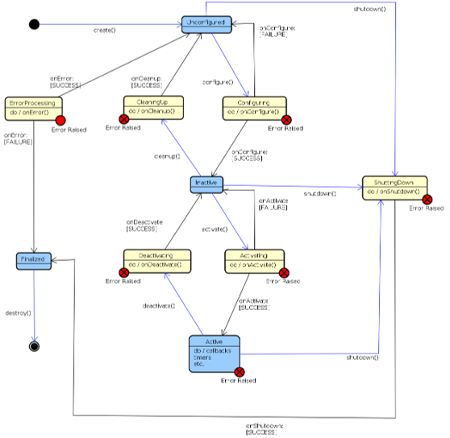

# Nodos de ciclo de vida

Los nodos de este repositorio están configurados como [nodos con ciclo de vida](https://design.ros2.org/articles/node_lifecycle.html), lo que nos permite poder lanzarlos y que queden en espera hasta que queramos activarlos. A su vez podemos desconfigurarlos para cambiar parámetros y volverlos a lanzar sin los nodos como tal se detengan.



## Seguimiento de manos
En primer lugar configuramos y activamos el cliente:
```bash
ros2 run hand_hri_mediapipe test_client configure
ros2 run hand_hri_mediapipe test_client activate
```

```bash
ros2 run hand_hri_mediapipe hand_client left
ros2 run hand_hri_mediapipe hand_client both
```

Al ser nodos de ciclo de vida necesitamos comenzar configurando los nodos, tras lo que hay que activarlos todos:
```bash
# Configurar nodos de vida
ros2 lifecycle set /hand_mediapipe_node configure
ros2 lifecycle set /hand_landmarks_3d_node configure
ros2 lifecycle set /hand_palm_plane_node configure
ros2 lifecycle set /hand_cam_to_base_node configure

# Activar nodos de vida
ros2 lifecycle set /hand_mediapipe_node activate
ros2 lifecycle set /hand_landmarks_3d_node activate
ros2 lifecycle set /hand_palm_plane_node activate
ros2 lifecycle set /hand_cam_to_base_node activate
```

Podemos obtener el estado del nodo de ciclo de vida
```bash
ros2 lifecycle get /hand_mediapipe_node
```